 

 

 

 
 

  

  
  &nbsp;
  

 

<picture>
  <source media="(prefers-color-scheme: dark)" srcset="https://raw.githubusercontent.com/cleibum2002/cleibum2002/output/snake-dark.svg" />
  
</picture>
